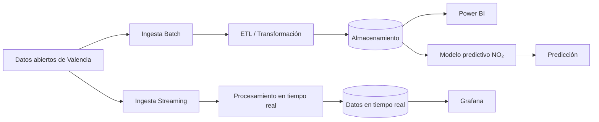

# Proyecto 4 · Plataforma de datos de Valencia

> Pipeline completo de ingeniería de datos (**batch + streaming**) sobre datos abiertos de tráfico, calidad del aire y meteorología de Valencia, con **Power BI** para los indicadores consolidados, **Grafana** para el tráfico en tiempo real y un **modelo predictivo de NO₂** como colofón.

## Descripción y objetivo

Construcción de un **pipeline completo de ingeniería de datos** utilizando fuentes de datos abiertos de la ciudad de Valencia relacionadas con **tráfico, calidad del aire y meteorología**.

El proyecto integra dos flujos de procesamiento:

- **Batch:** ingesta periódica de datos históricos y actualizados para su transformación, almacenamiento y análisis.
- **Streaming:** procesamiento de datos de tráfico en tiempo real para su monitorización mediante Grafana.

Los datos procesados se utilizarán para generar **indicadores consolidados en Power BI**, visualizar el estado del tráfico en tiempo real mediante **Grafana** y, como etapa final, desarrollar un **modelo predictivo de concentración de NO₂**.

## Arquitectura

*Diagrama provisional. Se actualizará a medida que avance el proyecto.*

## Fuentes de datos

| Fuente | Datos | URL / origen | Formato | Frecuencia de actualización | Licencia | Última ingesta |
|---|---|---|---|---|---|---|
| Datos abiertos de Valencia | Tráfico | Pendiente | Pendiente | Pendiente | Pendiente | Pendiente |
| Datos abiertos de Valencia | Calidad del aire | Pendiente | Pendiente | Pendiente | Pendiente | Pendiente |
| Datos meteorológicos | Meteorología | Pendiente | Pendiente | Pendiente | Pendiente | Pendiente |

## Tecnologías

| Tecnología | Uso |
|---|---|
| Python | Ingesta, transformación y procesamiento |
| Docker | Contenerización del entorno |
| MongoDB / PostgreSQL | Almacenamiento de datos |
| Apache Kafka | Streaming y procesamiento de eventos |
| Power BI | Análisis e indicadores consolidados |
| Grafana | Monitorización en tiempo real |
| Machine Learning | Predicción de NO₂ |

## Estructura del repositorio

| Carpeta | Contenido |
|---|---|
| `ingesta/` | Conectores y procesos de ingesta batch y streaming |
| `etl/` | Limpieza, transformación y procesamiento de los datos |
| `streaming/` | Procesamiento de datos de tráfico en tiempo real |
| `storage/` | Configuración y modelos de almacenamiento |
| `dashboard/` | Dashboards de Power BI y Grafana |
| `ml/` | Preparación de datos, entrenamiento y predicción de NO₂ |
| `docs/` | Documentación, capturas y diagramas |

## Cómo desplegar el entorno

Pendiente de completar cuando se defina el `docker-compose.yml` y la infraestructura necesaria para ejecutar los diferentes servicios del proyecto.

## Bitácora de prácticas

### Bloque 0 · Entorno

**Objetivo:** preparar el repositorio Git independiente del proyecto, definir su estructura inicial y establecer la base del entorno de trabajo.

**Pasos realizados:**

1. Creación del repositorio con `git init` y la rama `main`.
2. Creación de la estructura inicial de carpetas.
3. Configuración del `.gitignore`.
4. Redacción del README inicial.
5. Preparación del entorno de desarrollo.
6. Primer commit y publicación en GitHub.

**Problemas encontrados y solución:** ninguno por ahora.

**Resultado:** repositorio publicado en GitHub con la estructura inicial del proyecto.

## Equipo

- Jorge Esteban García
